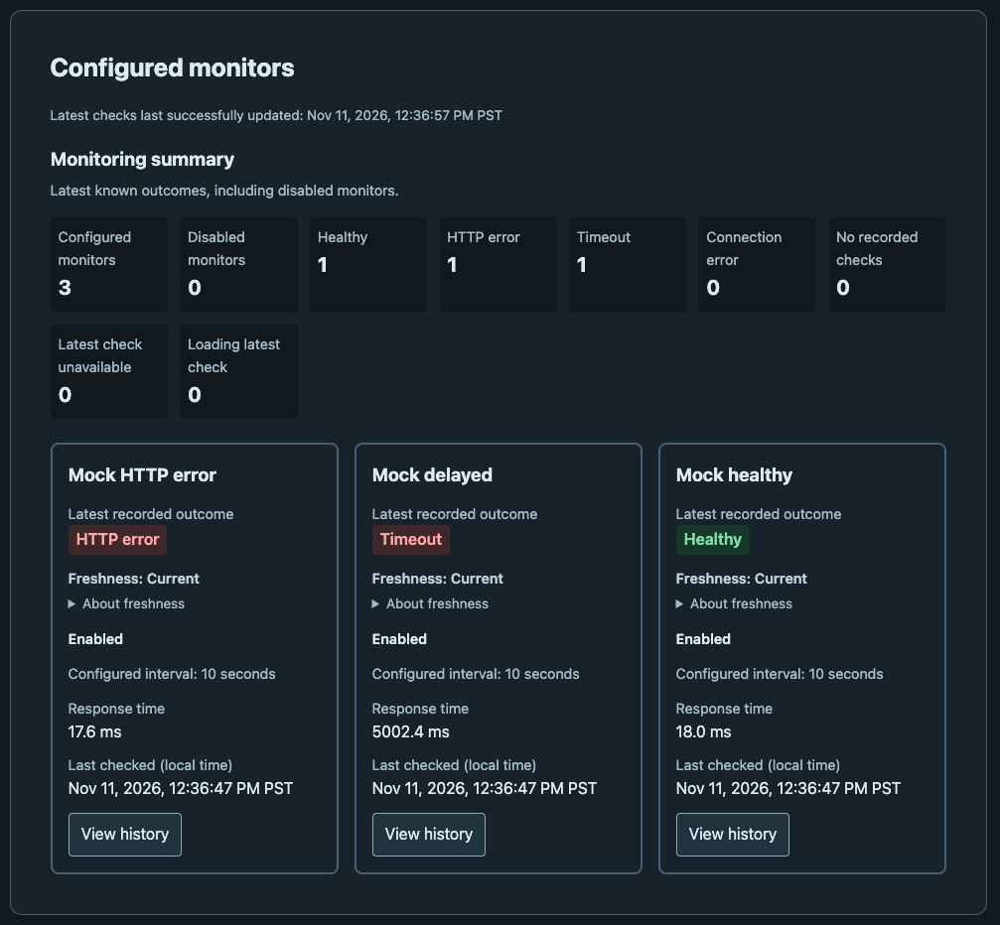
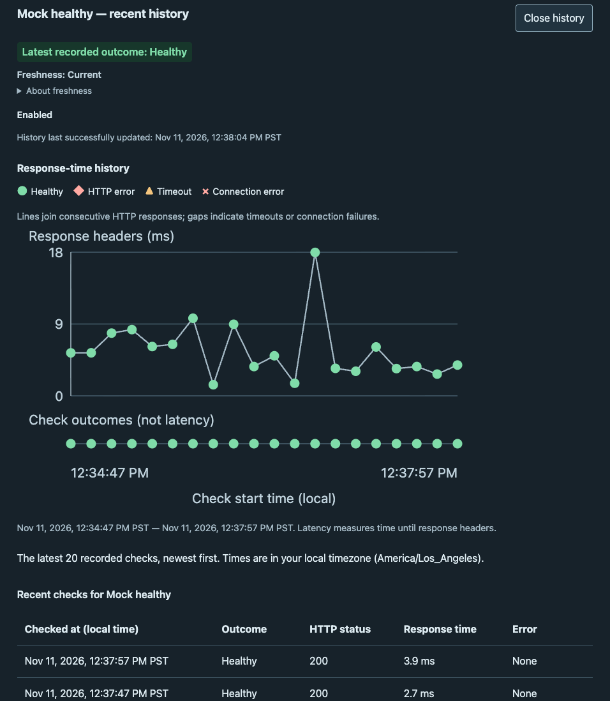

# Endpoint Watch

Endpoint Watch is a local HTTP monitoring dashboard for support engineers and
developers investigating service failures. It records scheduled checks in
PostgreSQL so users can inspect the latest known outcome and recent history.

The MVP and Milestone 4 dashboard/runtime improvements are implemented. The
application is intended for local/private use, with known security limitations
recorded in the [security maintenance report](docs/security.md).

## Features

- Scheduled checks with separate healthy, HTTP-error, timeout, and connection-error outcomes.
- Monitor overview, selectable history, local timestamps, and response-time charts with an outcome timeline.
- Independent result-freshness indicators, automatic/manual refresh, and retained data during API failures.
- Stateless on-demand checks against a configured target.
- Reproducible Compose environment, SQL migrations, and Vitest/Playwright tests with GitHub Actions.

**Stack:** TypeScript · Node.js 24 · Express · React/Vite · PostgreSQL/pg ·
SVG/CSS · Docker Compose/Nginx · Vitest · Playwright.

## Architecture and tradeoffs

The React frontend requests `/api` through Nginx's same-origin proxy. Express
reads monitor configuration and history from PostgreSQL. A separate Node worker
checks enabled targets and writes results; the mock API supplies local healthy,
HTTP-error, and delayed-response scenarios. PostgreSQL history lives in a named
Docker volume. See the [architecture](docs/architecture.md) for component details.

- **One worker:** simple interval scheduling prevents overlap per monitor within
  one process. Multiple workers would need coordination that is deliberately deferred.
- **Local/private deployment:** loopback-bound web/API ports keep setup small;
  public hosting needs additional access controls and security work.
- **Separate check paths:** scheduled checks persist to monitor history;
  on-demand checks return a result without changing that history.

Overdue results indicate missing recent observations, not confirmed endpoint
failure. Monitor-management endpoints, alerts, incident detection, and automatic
history retention are not implemented. Future ideas are listed in the
[specification](SPEC.md#8-future-enhancements-out-of-mvp-scope).

## Screenshots

### Monitoring dashboard



The dashboard provides an overview of monitored endpoints, including their latest known health status, response time, and check freshness. Results refresh automatically as the background worker performs scheduled checks.

### Monitor history



Selecting a monitor reveals its recent check history, including response-time trends, HTTP status codes, and recorded failures. This helps distinguish isolated errors from recurring issues.

## Prerequisites

- Docker with Docker Compose and a running Docker engine.
- A browser, `curl`, and a POSIX-compatible shell for the smoke test.
- No host Node.js or PostgreSQL installation is required for Compose.

## Docker Compose quick start

Run from the repository root. Create `.env` only if it does not already exist:

```bash
if [ ! -e .env ]; then cp .env.example .env; fi
```

Edit `.env` and set `POSTGRES_PASSWORD` to a local development password. Keep it
uncommitted. Preserve existing credentials when reusing an existing database volume.
Then start the environment:

```bash
docker compose up -d --build --wait
```

Open **http://127.0.0.1:8080** (or the `WEB_PORT` set in `.env`).

Expected: PostgreSQL, mock API, API, worker, and web become healthy; `migrate` completes
with exit code 0. This verifies startup dependencies, schema initialization,
and basic readiness. Frontend and API ports are published only on the host's
loopback interface; the browser uses the frontend origin for `/api` requests.

## Five-minute manual smoke test

Run after the quick start; initial image downloads/builds may take longer than
five minutes. These steps assume default ports (`WEB_PORT=8080`, `API_PORT=3000`),
6000ms mock delay, 5000ms request timeout, and enabled seeded 10-second monitors.
A reused database may contain additional monitors or changed settings.

1. **Confirm startup:** run `docker compose ps -a`. Expect five healthy running
   services and `migrate` exited with code 0. This proves startup readiness;
   worker health alone indicates liveness, not successful persistence.

2. **Open the dashboard:** visit `http://127.0.0.1:8080`. Expect Endpoint Watch,
   three seeded monitors, and summary counts. After worker checks finish, expect
   Healthy, HTTP error, and Timeout. This exercises the built frontend, Nginx's
   same-origin proxy, Express, and stored monitoring data. A new database may
   briefly show no recorded checks before the worker's first results arrive.

3. **View history:** Tab to the “View history” button on the Mock healthy card and press Enter.
   Expect focus on the detail heading and recent rows showing local timestamps,
   outcomes, HTTP status codes, response times, and errors. Close history and
   expect focus to return to the selected button. This checks keyboard navigation
   and retrieval of persisted history.

4. **Check refresh and worker progress:** keep the panel open for a worker interval
   and a dashboard refresh cycle (about 30 seconds), or use Refresh. Expect newer
   check timestamps/IDs and advancing successful-update times while selection
   remains intact. This verifies recurring worker writes and frontend polling.
   `docker compose logs --tail=30 worker` shows failures; successful checks are
   not logged. See [troubleshooting](docs/troubleshooting.md) if history stays stale.

5. **Verify API health and an on-demand check:**

   ```bash
   curl -i http://127.0.0.1:3000/health
   curl -i -X POST http://127.0.0.1:8080/api/checks/run
   curl -i http://127.0.0.1:8080/api/monitors
   ```

   Expect HTTP 200 for all three. Health returns `{"status":"ok"}`; the check
   reports `status: "healthy"` and `statusCode: 200`; the list has a `data` array.
   These verify Express health and browser-origin API forwarding. The on-demand
   check is not persisted. For a direct history check, enter a returned monitor ID:

   ```bash
   read -r MONITOR_ID
   curl -i "http://127.0.0.1:8080/api/monitors/$MONITOR_ID/checks?limit=5"
   ```

   Expect HTTP 200 and newest-first history for that monitor. IDs are not assumed
   to start at 1. PostgreSQL and mock API ports are not exposed to the host.

6. **Shut down safely:**

   ```bash
   docker compose down
   docker compose ps -a
   ```

   Expect no remaining service containers. The named PostgreSQL volume is retained,
   preserving history for the next start. Database deletion is a separate
   [destructive reset](docs/development.md#destructive-database-reset).

## Detailed documentation

- [Development](docs/development.md): Node, Docker, Compose, worker operation, rebuilds, and shutdown/reset.
- [API reference](docs/api.md): response formats, validation, and error behavior.
- [Database](db/README.md): PostgreSQL setup, schema, migrations, and repository types.
- [Testing and CI](docs/testing.md): local checks, PostgreSQL integration tests, and GitHub Actions verification.
- [Security maintenance](docs/security.md): supported runtime, audit results, and remaining container findings.
- [Troubleshooting](docs/troubleshooting.md): startup failures, credentials, ports, and missing history.
- [Product specification](SPEC.md) and [architecture](docs/architecture.md): requirements and design.

The smoke test is a developer verification procedure. Documentation/link checks
alone do not establish that your local environment or GitHub Actions run passed.
